# Aequitas architecture

How Aequitas turns video into summaries, labels and answers, and why each part is built the way it is. This
describes the code on `main` as of 2026-10-16. Measured numbers link to the file that holds them. A number
tuned on the same clips it is reported on is marked as a demo setting, not accuracy.

**Contents:** 1 Overview · 2 The three faculty stages · 3 Ingest · 4 Two analysis modes · 5 Second signals ·
6 Stage 1: summarise · 7 Stage 2: classify · 8 From windows to events · 9 Stage 3: chatbot · 10 Serving and
models · 11 Storage · 12 Web app and API · 13 Products on the same core · 14 Latency · 15 Evaluation tools ·
16 Guardrails · 17 Code map · 18 Limits and open work

---

## 1. Overview

Aequitas is a local-only system: no cloud API is called. Non-local model hosts are refused unless
`allow_remote: true`. It runs on one laptop: an RTX 4050 with 6 GB of VRAM.

```mermaid
flowchart LR
  subgraph Sources
    F[Video file / upload]
    R[RTSP camera]
    W[Webcam: OpenCV or browser]
  end
  Sources --> I[Ingest<br/>4 fps, ring buffer<br/>one thread per camera]
  I --> M{analysis.mode}
  M -- periodic --> G[4 s windows<br/>blank / static / SigLIP gate]
  M -- triggered --> Y[YOLO11n + ByteTrack<br/>rule triggers]
  G --> K[2x2 key-frame grid]
  Y --> K
  K --> S1[Stage 1 SUMMARISE<br/>VLM: Gemma 4 E2B]
  S1 --> S2[Stage 2 CLASSIFY<br/>text-only, constrained labels]
  V[Violence clip model<br/>r3d_18 ONNX] -.second signal.-> FU
  S2 --> FU[Fusion / cross-window agreement]
  FU --> DB[(SQLite<br/>events, windows, timings, FTS5)]
  DB --> S3[Stage 3 CHATBOT<br/>question to filter to SQL<br/>grounded streamed answer]
  DB --> UI[React app via FastAPI]
  S3 --> UI
```



The design rests on four decisions:
1. **The three faculty tasks are separate stages,** each with its own prompt, model endpoint, timing and
   metric. The summary is written without seeing the label list, and the label is chosen from the summary
   text alone.
2. **A VLM label is never trusted on its own.** The small VLM is biased: on CAVIAR it called 11 of 11 clips
   "person down" (docs/EVAL_CAVIAR.md). A second signal (a rule trigger, the violence clip model, or agreement
   across windows) decides whether an incident is *confirmed*.
3. **Latency is a design input.** Cheap stages run first and decide whether expensive ones run: blank and
   static skips, the SigLIP gate, rule triggers. Outputs are capped. Requests run concurrently for vLLM
   batching. Every stage is timed and stored.
4. **Everything is swappable by config:** models per stage, categories, cameras, thresholds. Defaults live in
   `aequitas/config.py` and overrides in `config/*.yaml`.

## 2. The three faculty stages

| Stage | Input → output | Code | Model (default) | Typical time (RTX 4050, Ollama) |
|---|---|---|---|---|
| 1 Summarise | 2×2 key-frame grid (JPEG) → `{summary ≤ 35 words, visible_evidence ≤ 8 words}` | `understand/stages.py`, `vlm_client.summarize`, `prompts.summarize_prompt` | `gemma4:e2b` (`vlm:`) | 0.8 s |
| 2 Classify | summary text (+ evidence, + previous window's summary) → one label from the category list or `none`, + confidence on vLLM | `vlm_client.classify_text`, `prompts.classify_text_prompt` | the same model unless `classifier:` overrides it | 0.38 s |
| 3 Chatbot | question → structured filter → SQL → grounded, streamed answer citing `[#id]` | `aequitas/chat/` | the same model unless `chat:` overrides it | ~0.7 s per question parse with Gemma |

One window takes **1.2 s** for both stages (warm p50, docs/DESIGN.md §4.4). `Understanding` keeps
`summarize_ms` and `classify_ms` apart. They are stored per window and per event, and shown on every camera
tile and report.

## 3. Ingest

**`ingest/frame_source.py`** gives one interface for files, RTSP, webcam indexes and **push sources**. A push
source is a browser webcam: the page sends JPEGs to `POST /api/live/cameras/{id}/frame` and the server never
opens a device.
- Reading runs in its own thread, so a slow consumer never stalls the stream.
- Live sources keep only the newest frame.
- Files are either paced at native speed (`realtime: true`, simulated live; `loop: true` for demo footage)
  or read losslessly for evaluation.
- Frames are sampled at `sample_fps` (4).

**`ingest/ring_buffer.py`** keeps the last `ring_buffer_s` (12 s) of frames per camera, downscaled to ≤ 960 px
wide, with each frame's track boxes. Key-frame grids are built from it.

**Threads:** one camera thread per camera, plus `vlm.concurrency` understanding workers that share one bounded
job queue (`pipeline.JobQueue`). When a camera's backlog is full, its lowest-score job is dropped and the drop
is recorded (`dropped_candidates`).
- **Live cameras** queue a new window only once the previous one has been taken. If the VLM is slower than
  real time, windows stretch instead of piling up.
- **Files** wait for room (backpressure), so no window is skipped.

## 4. Two analysis modes

`analysis.mode` in settings. The live dashboard and bodycam uploads always use **periodic**.

### 4.1 Periodic: every window is reviewed (`pipeline._periodic_step`)

Each camera's stream is cut into `window_s` windows (4 s). Before the VLM, three cheap checks can skip a
window. Each skip is recorded in `stage_timings` with its reason.

| Check | What it does | Cost | Measured |
|---|---|---|---|
| Blank picture (`skip_blank_below: 6`) | Highest grayscale std of the frames. Below 6 = black, covered or blank. | < 1 ms | Black webcam frames had produced a *confirmed* "fighting" (clip model 0.96, Gemma invented two people). Demo clips are all ≥ 41. |
| Static (`skip_static_below`, off by default) | Mean frame difference. Nothing moved, so the previous understanding still holds. | < 1 ms | Part of the 33.1 → 5.4 s time-saved ladder (results/ablation/README.md) |
| SigLIP scene gate (`gate_model`) | Zero-shot image–text scores against normal-scene and incident descriptions. Clearly normal → skip. | 17 ms / window | 72 saved windows: skipped 28/33 normal, 0/39 incident; −28 % Gemma time (results/improvements/README.md). The threshold was chosen on those windows. |

The VLM still looks at least every `max_skip_s` (30 s), and the gate never skips when the violence clip model
is uneasy (≥ `escalation.violence_band_low`). A window that passes becomes a 2×2 grid of four frames in
time order (`understand/keyframes.py`, 448 px tiles), which goes to stage 1, then stage 2.

### 4.2 Triggered: YOLO and rules decide when the VLM looks (`pipeline._triggered_step`)

Per frame:
1. RF-DETR-Small detects people and bags (`vision/detector.py`, `detector.family: rfdetr`, ~27 ms/frame on the 4050;
   0/6 → 3/6 CAVIAR rule hits against YOLO11n, docs/DETECTION.md). `family: yolo` uses YOLO11n (12.7 ms/frame); it's
   also the fallback when the `rfdetr` package isn't installed.
2. ByteTrack (Ultralytics' `BYTETracker`; OC-SORT via `tracker.algorithm`) keeps IDs per camera, with people
   and bags tracked separately.
3. Motion energy is measured on the person boxes.
4. Optional: the violence clip model, and the hazard detector (fire, smoke, weapons).
5. The rule engine (`triggers/`, one rule per category, a cooldown and episodes) emits **candidates**:
   person down, with YOLO pose on the crop for torso angle; fighting; tailgating over an entry line;
   overcrowding in a zone; loitering; abandoned object.
6. A candidate's grid is drawn **with red boxes on the people involved** and sent to stages 1 and 2 with the
   "highlighted" prompt.
7. `understand/fusion.fuse` combines the rule's score with the label:
   - **agree → confirmed**, confidence 0.6 + 0.4 × score
   - VLM says `none` → rejected
   - a different incident, or no answer → disputed

   Confidence comes from agreement, not the VLM's self-report.

Tracking choice is measured in docs/TRACKING.md: on CAVIAR ground truth the tracker moves IDF1 by ≤ 0.02,
while the detector moves it 3×. DeepSORT was rejected. Detector choice is measured in docs/DETECTION.md: RF-DETR-Small
finds 16× more small CAVIAR people than YOLO11n (AP50 0.425 vs 0.102) for ~15 ms more per frame; not integrated yet.

**Why periodic is the main mode now:** on low-resolution CCTV the rules found 0 of 6 CAVIAR incidents
(docs/EVAL_CAVIAR.md). YOLO11n misses small, high-angle people, so the rules never fire. Periodic mode doesn't
depend on detection.

## 5. Second signals

| Signal | Code | Used where | Measured |
|---|---|---|---|
| **Violence clip model:** r3d_18 trained on SCVD + RLVS + RWF-2000, ONNX, scores 2 s clips | `vision/violence.py`, `kaggle/violence_clip.py` | periodic: max score per window → `fuse_window`, and a vote towards confirmation; triggered: the fight trigger | val acc 0.95 (threshold calibrated on val); 6/6 faculty clips (Gemma alone 0/5); unseen real CCTV (300 clips): recall 0.93 but 45 % false alarms at 0.51, 0.77 / 14 % at 0.9; results/violence_clip/README.md |
| **Rule triggers** | `triggers/` | triggered mode | unit-tested on synthetic tracks; weak on CAVIAR (above) |
| **Agreement across windows** | `understand/periodic.WindowAggregator` | periodic: 2 agreeing windows → confirmed | (§8) |
| Hazard detector (YOLO fire/smoke/knife/gun/stick) | `vision/hazards.py`, `kaggle/hazard_detector.py` | triggered, optional | written and smoke-tested, **not trained on real data yet** |
| Skeleton action model (YOLO pose + STGCN++, NTU-120) | `vision/skeleton.py` | **prototype, not wired in** | 12 ms/frame + 32 ms/window; weak on CCTV clips, untested on the webcam (§13) |

`fuse_window` (periodic):
- Both see violence → kept, marked `both`.
- The VLM named a different incident (arrest, person down) → the VLM's more specific label wins.
- Only the clip model sees violence → `fighting`, but only at ≥ 0.9 (`violence_alone_threshold`). Busy street
  windows reach 0.8–0.9, faculty fights 0.95–1.0, so this is a demo setting chosen on our clips.
- Only the VLM sees violence → kept: a missed fight is worse than a false alarm a human dismisses.

## 6. Stage 1: summarise

`prompts.summarize_prompt` is built so the summary helps stage 2 without leaking a label:
- **The category list is never shown,** so the summary isn't steered towards a label.
- **The prompt never says which rule fired,** so the answer is an independent check, not an echo.
- **"Describe only what is visible."** Name the main action with a specific verb (punching, handcuffing,
  burning), never "interacting". Mention uniforms, handcuffs, weapons, flames, damaged vehicles, thrown
  stones. Say how many people there are and their posture.
- **The grid is explained** as four frames from the same camera in time order. The same person usually appears
  in several frames, so people are counted within one frame. This fixed a webcam failure where one person
  waving became "another person raises a hand" and was then labelled harassment.
- **The close view** (`view: close`, used for the webcam and bodycam) asks for hands, arms and posture per
  person, and says never to describe faces or who anyone is.
- **Output is forced JSON and capped:** ≤ 35-word summary, ≤ 8-word evidence, `summary_max_tokens: 128`.
  Decode time grows with every token. The capped summary is one step of the time-saved ladder.

A cascade (`escalation:`) can re-run both stages with a bigger model on flagged windows. It's off: the E4B
cascade crashed Ollama on 6 GB (docs/RESEARCH_CHECK.md §7), and the SCVD comparison showed cascades don't raise
recall.

## 7. Stage 2: classify the summary

**The label set is configurable** (`categories:` in settings; `aequitas/taxonomy.py`). There are 14 police
categories by default: harassment, fighting, riot, weapon, fire, arrest, chase, person_down, accident, theft,
vandalism, crowd_incident, tailgating, suspicious_activity. Each has a one-line definition written as an action,
never as who someone is. The `none` definition explicitly includes:
- peaceful gatherings, protests and processions
- police doing their job with nobody held
- people sitting, standing, talking, waving or gesturing

The faculty dataset's labels can replace the list with no code change. The database has no CHECK constraint on
categories any more.

**Prompt** (`classify_text_prompt`):
- the summary, the evidence, and optionally **the previous window's summary** from the same camera
  (`label_context`), "only to understand a sequence"
- choose one category or `none`; if several fit, the more serious one
- sports and play are `none`
- fire beats the labels a burning scene gets confused with

Previous-window context raised flagged incident windows from 22 to 25 of 39 with 0 false alarms
(results/improvements/README.md).

**Decoding:**
- **vLLM / OpenAI-compatible:** structured outputs, `extra_body={"structured_outputs": {"choice": [...]}}`.
  The model can only emit a valid label. The label's **token log-probabilities give the confidence**
  (`vlm_client.label_confidence`).
- **Ollama:** a JSON-schema enum. Always valid, but no confidence.

**Measured:**
- 0.983 accuracy and macro-F1 0.991 on 57 hand-written summaries (`aequitas eval-classify`). This is a
  regression set used during prompt work, not an accuracy claim.
- Webcam false alarms: 57/120 → 6/120 labels after the definitions fix (commit e0c2791).

## 8. From windows to events

- **Periodic** (`understand/periodic.WindowAggregator`):
  - A window labelled with an incident opens an *unverified* event (confidence 0.4).
  - A second agreeing window within `max_gap_s` (10 s) makes it **confirmed** (0.7, +0.05 per extra window,
    capped at 0.9).
  - The violence clip model at ≥ 0.9 also votes `fighting` (`clip_votes`). Faculty fight clips are only two
    windows long, and Gemma often calls one of them something else.
  - Results from concurrent workers are applied **in window order per camera** (`stages.InOrder`), because the
    aggregator assumes time order.
- **Triggered:** one event per candidate episode. Its end time is extended while the rule stays active.

Each event stores:
- the camera, start and end time, category and status (confirmed / unverified / disputed / rejected)
- confidence, the VLM's label, the summary
- a key-frame JPEG
- model versions
- timings: detect, trigger, queue, summarize, classify, processing and end-to-end

Each window is also stored (`windows` table): summary, label, confidence, timings, violence score and source.
Uploads are capped at `keep_windows` (200) per camera; bodycam recordings keep every window.

## 9. Stage 3: chatbot

The LLM never writes SQL and never lists events. The flow:
1. **Parse** (`chat/parser.py`). The LLM fills a small JSON form: categories, camera mentions, time range,
   status, count-or-list intent. A keyword parser reads the same question.
   - `reconcile` keeps the explicit words for intent and time, because Gemma read yes/no questions as counts
     and invented times.
   - Code resolves camera names and aliases and sanity-checks times.
   - Result: 28/28 on dev questions and 20/20 held out, where Gemma alone got 19/28 and 15/20
     (results/chat_eval/README.md).
2. **Retrieve** (`store/query.py`). `QueryFilter` → parameterised SQL, plus SQLite FTS5 on summaries.
   Confirmed events only, unless the question asks for unconfirmed ones.
3. **Answer** (`chat/answer.py`). The event list comes from the database rows, each with an `[#id]`.
   - An optional short LLM summary is kept only if every ID it cites was retrieved (`is_grounded`); otherwise
     it's dropped.
   - `POST /api/ask/stream` streams it over SSE in this order: `retrieved` (rows + parse and query time),
     tokens, then `done` (TTFT, total).

## 10. Serving and models

| Piece | Default | How it's served | Notes |
|---|---|---|---|
| VLM (stages 1–2, chat) | **Gemma 4 E2B** (`gemma4:e2b`, Q4 in Ollama) | Ollama on the laptop today. `OpenAICompatClient` for vLLM (or llama.cpp, LM Studio) by changing `vlm.backend/host/model`. | Chosen as the default on 2026-10-15 (CPU spike: ~16 s vs 44 s for Qwen2.5-VL-3B). Fits 6 GB, 3.4 GB in use. Fine-tuned distillation from 12B is in progress (`kaggle/finetune_gemma.py`). |
| vLLM profiles | `scripts/vllm/serve.sh`: `QUANT=bf16\|fp8\|<path>`, `SPEC=none\|mtp\|ngram` | WSL2 on the laptop (**WSL not installed yet**) or Kaggle | MTP uses Gemma's `-assistant` drafter checkpoint; n-gram speculation for chat answers, which copy retrieved text. |
| Quantised checkpoints | `scripts/quantize/quantize.py`: FP8_DYNAMIC, W8A8 (SmoothQuant + GPTQ), W4A16 (GPTQ) | llm-compressor → compressed-tensors, loaded by vLLM | Vision towers, embeddings, per-layer embeddings and lm_head stay BF16. |
| Violence clip model | r3d_18, ONNX (127 MB, not in git) | onnxruntime, in-process | `models/violence_clip/` |
| SigLIP gate | `google/siglip-base-patch16-224` | transformers, in-process | ~0.8 GB download on first start |
| YOLO11n, YOLO11n-pose | Ultralytics | in-process | triggered mode, person-down pose, skeleton prototype |

**About the ablation** (`kaggle/ablation.py`, results/ablation/): 3 models × FP16/W8A8/W4A16 on vLLM (Kaggle T4).
- Its automatic recommendation reads "Qwen3-VL-2B FP16", but only because it was the only model that ran
  fully. Gemma 4 can't start on a T4: a Triton kernel needs 96 KB of shared memory per block and the T4 has
  64 KB. The RTX 4050 has 100 KB, so it isn't affected.
- Every quantised configuration failed on environment issues, which are fixed in the notebook.
- **Gemma 4 E2B stays the model.** The ablation will be re-run at the end for the quantisation and
  speculation tables in the presentation.

## 11. Storage

One SQLite file (`data/aequitas.db`). WAL mode lets the UI read while the pipeline writes, and one connection
is shared behind a lock. Schema: `aequitas/store/schema.sql`. Migrations are additive (`ALTER TABLE … ADD
COLUMN` if missing).

| Table | Holds |
|---|---|
| `cameras` | id, name, aliases, source, view |
| `events` + `events_fts` | events (§8) and a full-text index on summaries |
| `event_timings` | per-event stage timings |
| `windows` | every analysed periodic window (summary, label, timings, violence score, source) |
| `stage_timings` | per-run record of every window: analysed, gated, skipped, blank. Used for each upload's latency panel. |
| `uploads` | uploaded videos and bodycam recordings: status, mode, `started_at`, total time, recording summary |
| `dropped_candidates` | jobs dropped by backpressure |
| `users`, `sessions`, `audit_log` | police accounts (scrypt), hashed session tokens, who did what |
| `reports` | citizen reports: tracking-code hash, sha256 of the file, authenticity result, police notes |

Key frames are JPEGs under `data/keyframes/<camera>/<day>/`.

## 12. Web app and API

**Backend** (`aequitas/web/server.py`, FastAPI, binds to 127.0.0.1). The full API is at `/api/docs`. Groups:
- auth: `/api/auth/*`
- events, cameras, stats, categories
- chat: `/api/ask`, `/api/ask/stream`
- uploads: `/api/uploads*`, with the background `JobManager` running one job at a time through the normal
  pipeline
- live: `/api/live/*`, through `LiveManager`. Selecting a locality starts a periodic pipeline on its cameras
  and stops the previous one, because one 6 GB GPU can't analyse the whole city.
- MJPEG preview, the browser-camera frame push
- citizen reports: `/api/citizen/*`, no account, rate-limited
- police report review: `/api/reports*`
- bodycam: `/api/bodycam*`

Police endpoints need a signed-in session. Citizen endpoints never do.

**Frontend** (`frontend/`: React 19 + TypeScript + Vite, react-router). FastAPI serves the built
`frontend_dist/`. The old plain-JS pages in `web/static/` are only a fallback when the React app isn't built.

| Page | What it shows |
|---|---|
| Login | police sign-in (demo `admin/admin` is created only on an empty database, flagged in the audit log) |
| Live CCTV | Bengaluru localities (`config/bangalore.yaml`) → camera tiles with the latest summary, label, **summary and label time**, seconds behind live; averages across tiles; the laptop webcam as a camera (`BrowserCamera`) |
| Active requests | open citizen reports, longest waiting first, with video, AI findings, AI-generated likelihood |
| Bodycam review | upload → timeline of 4 s summaries, key moments to Confirm/Dismiss (audited), whole-recording overview, printable report marked as an AI draft, **total and per-stage time** |
| All reports | the citizen-report archive with each analysis's total time |
| Citizen portal (`/report`) | public upload, report ID + one-time tracking code |
| Analyst chat | streamed, grounded answers with `[#id]` links |

## 13. Products on the same core

- **Live CCTV (Part 3, public order):** periodic mode on looping street footage standing in for cameras, plus
  the laptop webcam.
- **Bodycam review (Part 2)** (`web/bodycam.py`, `understand/recording_summary.py`):
  - The recording becomes its own camera, analysed with the close-view prompt; every window is kept.
  - The whole-recording summary is one text-only call over the window summaries (~3 s): an overview plus ≤ 8
    timestamped key points.
  - **Grounding:** a key point must sit on an analysed window and be ≥ 2 windows from the previous one;
    otherwise it's dropped.
  - Officers confirm or dismiss each AI moment. The AI status and the human decision are stored separately.
- **Citizen reports** (`reports.py`, `authenticity.py`):
  - Each file is fingerprinted with sha256 (re-uploads are linked) and analysed by the same pipeline.
  - An **AI-generated likelihood** comes from C2PA provenance, generator metadata, camera metadata and an
    optional frame classifier. It's evidence for a human, not proof.
- **Webcam, close range:**
  - Today: the close-view prompt + the definitions fix (§7).
  - Prototype: `vision/skeleton.py`, YOLO pose + STGCN++ trained on NTU RGB+D 120 (PYSKL checkpoints, plain
    PyTorch port, loads strictly). NTU's classes separate waving, thumbs up and sitting from punching,
    pushing and falling.
  - On CCTV demo clips the incident scores stayed low (≤ 0.25), so it's not wired in. Next step: test on a
    recorded webcam clip (`scripts/skeleton_check.py --record 20`).
  - NTU is for non-commercial research only.

## 14. Latency (weighted most heavily by the faculty)

"Total execution time" = video in → summaries, labels and a chatbot ready to answer.
- **Where it's measured and shown:**
  - `uploads.started_at` → finished = each upload's total, shown on the bodycam and report pages.
  - `stage_timings` gives the per-window split.
  - Live tiles show summary and label time and the lag behind live.
  - `aequitas stats` summarises recorded events.
- **Levers already in, measured:**
  - capped summaries
  - blank and static skips
  - the SigLIP gate (−28 % Gemma time)
  - constrained classification (a few output tokens)
  - concurrent workers (`vlm.concurrency`) for vLLM batching

  Time-saved ladder on an 80 s video (Kaggle T4, vLLM, Qwen FP16):
  **33.1 s → 5.4 s (6.1×)** from batching 8 windows, short summaries and static skips
  (results/ablation/README.md).
- **End to end, current setup:** 21 demo clips in **1 min 48 s** on the RTX 4050 with Ollama. 7 of the 10
  incident clips were confirmed, with 1 false alarm (results/improvements/README.md §5). Run-to-run noise is
  about ±2 confirmed.
- **Still to measure on the laptop:** vLLM (needs WSL), MTP and n-gram speed-up with acceptance rate
  (`aequitas bench` reads vLLM's `/metrics`), FP8 / W8A8 / W4A16 latency × accuracy. These go into
  docs/QUANTIZATION.md and the presentation.

## 15. Evaluation tools

| Command / script | Measures |
|---|---|
| `aequitas spike` | detector, pose and VLM latency and memory on this machine (unique image per call: Ollama caches identical prompts) |
| `aequitas bench` | TTFT, time per output token, tokens/s and total for the three tasks at several concurrency levels, plus the speculative acceptance rate |
| `aequitas eval-classify` | stage-2 accuracy, macro-F1, confusion and latency on labelled summaries |
| `aequitas eval-chat` | chat filter parsing, scored per field (dev + held-out questions) |
| `aequitas eval-dataset` | **faculty dataset adapter:** folder-per-label or a CSV/JSON manifest → all stages → accuracy, macro-F1, summary similarity, time per video and total |
| `aequitas eval-report` | recorded events per clip against expected labels (CAVIAR, demo clips) |
| `scripts/bench_variants.py` | prompt and setting variants on a fixed set of 72 saved windows |
| `scripts/replay_confirm.py` | confirmation rules replayed on saved runs |
| `scripts/webcam_labels.py` | stage 2 re-run on saved webcam windows (false-alarm check) |
| `scripts/tracker_compare.py` | trackers on CAVIAR ground truth (IDF1, MOTA, ID switches, time) |
| `scripts/skeleton_check.py` | pose + skeleton actions per window on any video, or a webcam recording |
| `kaggle/*.py` | ablation, model comparison, violence clip and hazard training, Gemma fine-tune (run as notebooks on Kaggle; the deliverable has no notebooks) |

## 16. Guardrails (design, not options)

- No face recognition or identification of anyone. Prompts say never to describe faces or who someone is; the
  skeleton model sees keypoints only.
- No classification of people by religion, caste, party, flags, slogans or attire. Category definitions
  describe actions, and fine-tune training data with such words is dropped.
- A peaceful gathering, protest or procession is never an incident. This is written into the `none`
  definition.
- **A human confirms incidents.** AI statuses are suggestions; officers' decisions are audited and stored apart
  from the AI's.
- Appearance re-identification (e.g. DeepSORT embeddings) isn't used (docs/TRACKING.md).

Full text: docs/POLICE_EDITION.md §8.

## 17. Code map

```
aequitas/
  config.py            pydantic settings (defaults); config/*.yaml overrides
  pipeline.py          camera threads, job queue, understanding workers, both modes, event writing
  taxonomy.py          default categories and the none definition
  ingest/              frame_source (file/RTSP/webcam/push), ring_buffer
  vision/              detector (YOLO + ByteTrack), pose, motion, violence (clip ONNX), hazards, skeleton (prototype)
  triggers/            one rule per category + engine (cooldown, episodes)
  understand/          prompts, vlm_client (Ollama / OpenAI-compatible), stages (1 + 2, InOrder), keyframes,
                       gate (SigLIP), fusion, periodic (WindowAggregator), recording_summary
  store/               schema.sql, db (EventStore), query (QueryFilter -> SQL)
  chat/                parser (LLM form + keywords + reconcile), answer (grounded, streamed)
  web/                 server (FastAPI), jobs (uploads), live (localities), bodycam
  auth.py reports.py authenticity.py
  eval/                spike, bench, classify_eval, chat_eval, dataset (faculty adapter), report
frontend/              React + TypeScript (Vite)
scripts/               vllm/, quantize/, evaluation and benchmark scripts
kaggle/                training and study scripts (.py; notebooks built from them for Kaggle)
config/                settings, cameras, localities, evaluation sets
tests/                 unit tests on synthetic data (no model downloads)
```

## 18. Limits and open work

- **Accuracy on real incidents is modest.**
  - SCVD incident recall: E2B 0.15, 12B 0.70 (Kaggle T4). The fine-tune distils 12B into E2B; run 1 kept only
    96 of 1,654 teacher summaries, and run 2 has a looser self-check.
  - Fights rely on the violence clip model.
  - Riots are untested on real Indian footage, and the report must say so.
- **CCTV detection:** YOLO11n is too weak for low-res, high-angle footage. YOLO11m at 960 px tripled tracking
  quality on CAVIAR, but its latency is untimed.
- **Serving:** vLLM, MTP and quantisation still need laptop numbers (WSL).
- **Small sets:** several thresholds were chosen on the demo clips themselves (the clip-model 0.9, the gate
  0.3). They're demo settings, not measured accuracy.
- **Faculty dataset:** not arrived. The adapter exists (`eval-dataset`).
- **supervision is capped below 0.31,** where its `ByteTrack` was removed. Tracking now uses Ultralytics,
  and only `sv.Detections` is still used. Lift the cap once 0.31 is tested.
